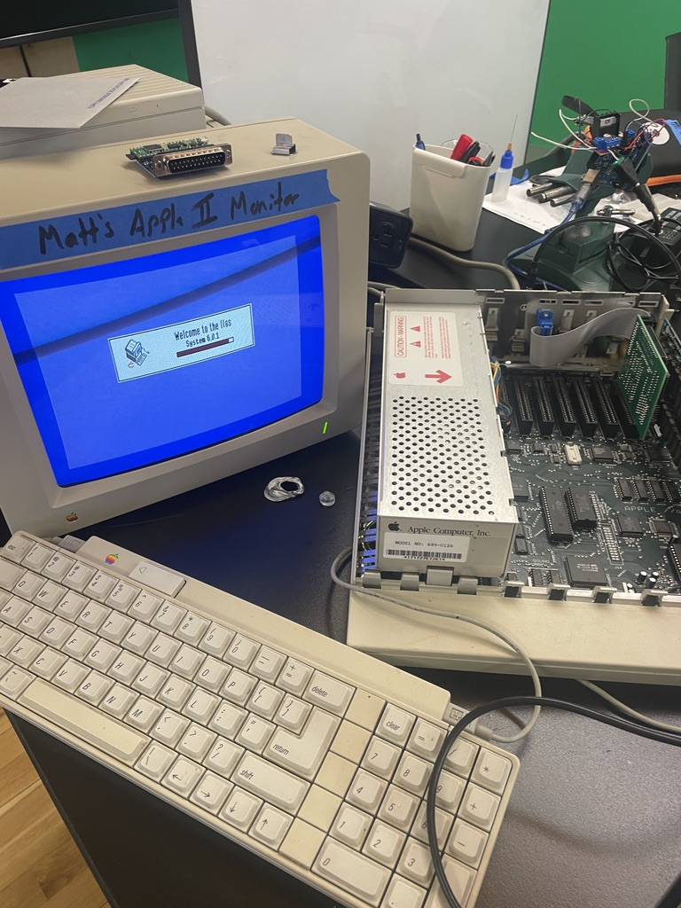
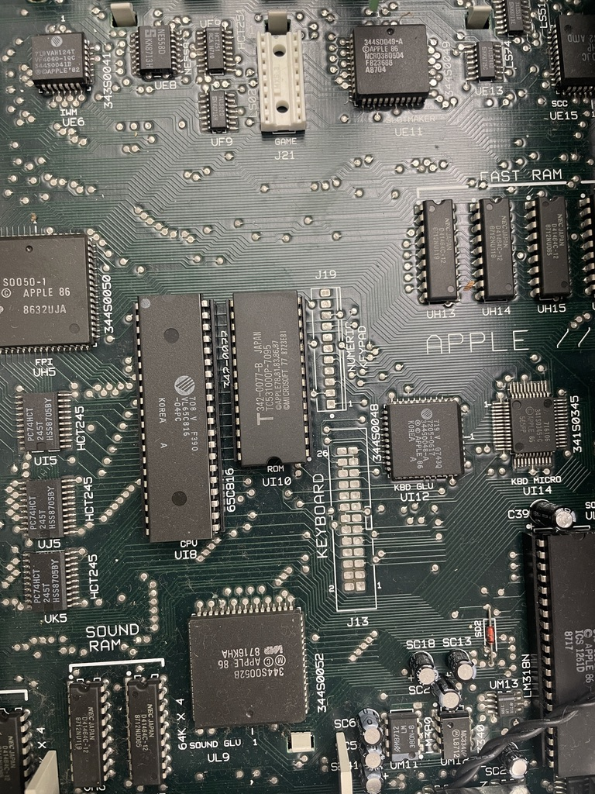
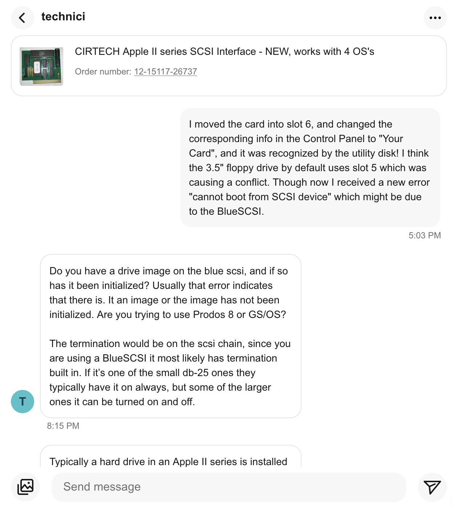
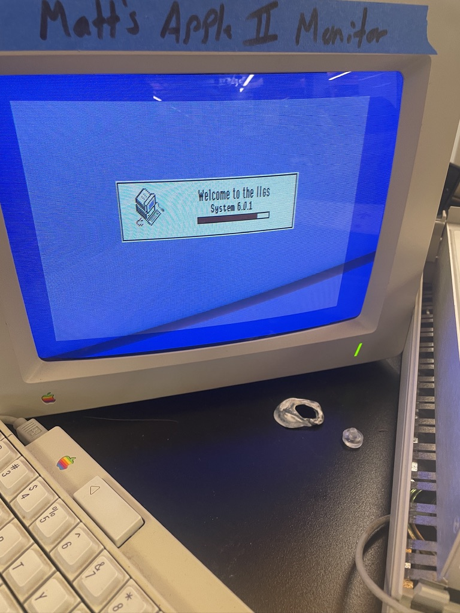
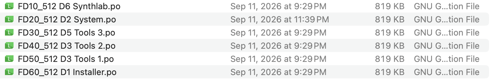
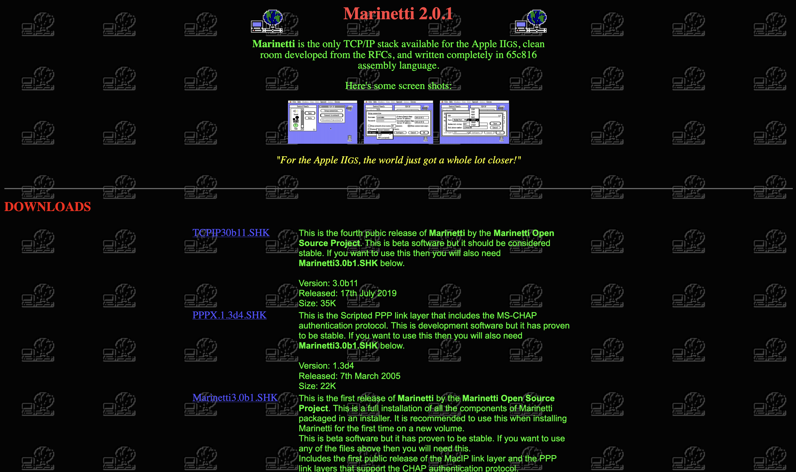
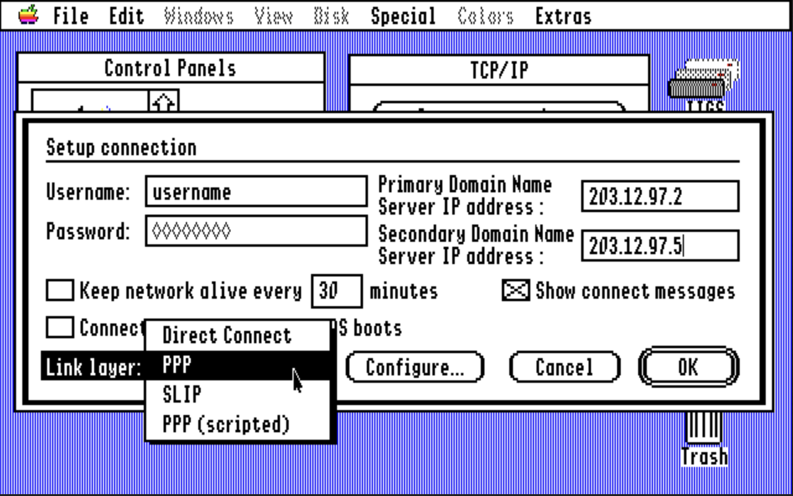
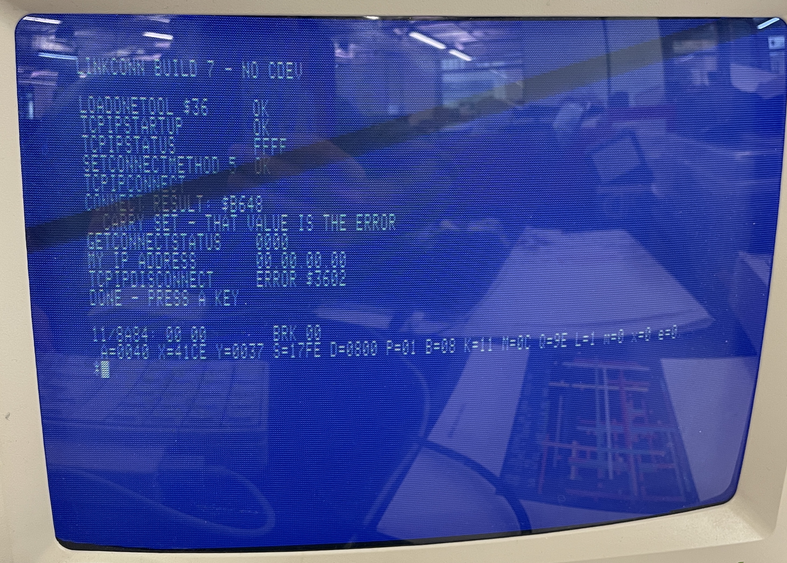
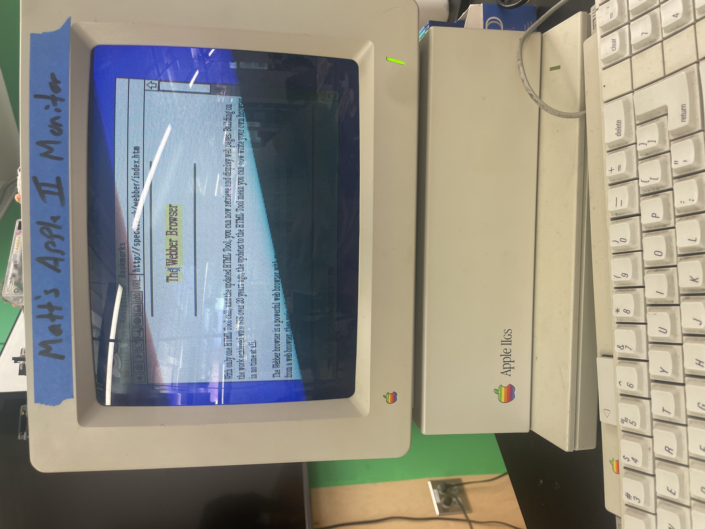

## Old Computers and Modern Networks

#### Exploring the recent past

In 1986 Apple released the Apple IIGS. Their first 16-bit computer with a graphics and sound system. It planted the early seeds of Apple's interface design and many early methods that we continue to use Macs now.

Unlike modern computers, the Apple IIGS functioned on a 320x200 resolution, had between 516k to 8mb of RAM, included an analog synthetic sound chip, and ran software off of floppy disks written in BASIC and Assembly. It had ways to network with other early Apple computers even though it existed before the Internet as we know it came to be. I also have a personal connection to the device. The Apple II I was experimenting with had been sitting in my Dad's attic for ten years, and before that it was originally found at a garage sale by my older brother. Already a 40 year old computer had survived long enough come into my hands. Since the computer existed in such a different time than what I was familiar with, I wanted to try and "revive" it. To see what it would take to make it function in a similar way we interact with computers now. One friend had asked "Can it connect to the Internet", and after saying "No, it existed before the Internet", my friend followed up by asking "Oh, well what can it do?". I realized the main way we engage with computers are as networked devices and rarely as individual objects that can complete specialized tasks. 

Before beginning any interesting experiments, I wanted to get the computer connected a WiFi network and subsequently the Internet. First I found [several articles](https://happymacs.wordpress.com/2023/02/08/putting-an-apple-iigs-on-the-internet/) of people trying to connect vintage computers to the Internet, and luckily there exists a [large hacking community](https://www.applefritter.com/) for older devices too. At first, I came across a custom motherboard expansion board a hobbyist had developed. Several other custom cards also existed with lively forum threads with active conversations. There was a challenge identifying what would be the right card to connect my Apple II to the Internet, and be flexible enough for more exploration. Luckily, a friend had pointed me to a more accessible (and cheaper) [BlueSCSI card](https://bluescsi.com/). The card is a popular and open-source platform to extend the capabilities of vintage computers from increased storage from a microSD card, reading a variety of antiquated disk file formats, and providing network access through a connected Raspberry Pi Pico W.

<div class="row justify-content-center">
  <div class="col-6">
    
  </div>
</div>

<div class="row justify-content-center">
  <div class="col-6">
    
  </div>
</div>

So I ordered the DB-25 variant of the card since it was the most recommended for Apple II and early Macintosh computers. DB-25 were a common standard for serial data communication during the 1980s, and SCSI stands for "Small Computer System Interface" which exists as a set of standards for connecting and transferring data between computers and peripheral devices. Through a custom PCB developed by the BlueSCSI team, and the modern ability of the Raspberry Pi Pico, the two were able to work within an antiquated, but working, computing standard. After eagerly checked its shipping details to continue my not-new experimental research. 

Though it wasn't as easy as I thought because I realized after the card arrived, by default, the Apple II did not natively come with a DB-25 port.
#### Working with old protocols

Even though SCSI was a data communication standard, an expandable motherboard card was needed to add the DB-25 port to the computer. Some quick searches on Ebay led me to the [Apple II Rev C SCSI card](https://www.ebay.com/itm/168668777792?_skw=apple+II+scsi+card&itmmeta=01M6SEFNQT09CXX1EHYZYNSVJM&hash=item2745714d40:g:5hoAAeSwsUpqnZet&itmprp=enc%3AAQALAAAA8CHNgUiiE%2FjQhlDTaMiAde%2BH1opfBrpIPAH0krFOxd7bs7pLH9WnWbvST%2FEPKPRhZT29s%2Fye021F1Ra8frwru5zRH7psfnjIurZs%2BGslKfF8RsVmfIyKTD89Ofn%2FJ4eAUAw4JSLwAqCTZ5CwjoayOya4oMJmlfDYzbjdIfsB1CbPiXNBoefNQqXTTwH%2B23Qa%2BehX%2FxshqItl1JCVW5T2gtfPSBNEnavE%2F8RGqqWUwasLzu2qTFdz58WKMA15wEK%2Ftakq6A6eMMUOcg%2FfoiLYu0PQUVH9HkObJbS9b35Bed7FjdIw2vh4BjP%2BJkOXanup4w%3D%3D%7Ctkp%3ABk9SR4rcvq62aA). A true-to-life copy (or in some cases untested vintage) card to handle SCSI data. As a graduate student, I couldn't afford it and instead opted for a [cheaper third-party card](https://www.ebay.com/itm/186388727683?_skw=apple+II+cirtech+scsi&itmmeta=01M6SES65NK645VHPBYP65T10Y&hash=item2b65a24783:g:uEQAAOSwNGNmB1KB&itmprp=enc%3AAQALAAAA8CHNgUiiE%2FjQhlDTaMiAde%2FeWUKge%2FgAbrU4lzwe%2B%2F2SCZ0K4eebddo6SNH221nGLn%2B97%2FOM8OV%2FT17EQxscU%2B4FRvsbjiQ%2BAD5V70At9eZvSOAPket0Xlbf3NreByAraGJgpeBqe1WGt4vA6Qw7TsQGSlmbiiFnaDYyb9X7EGPCF03XUHzVxvvUO%2B5Yj5PbKJKK--wYQgwXEHEUYeQTbopcXGG49ECekA99P8t%2FmaxC9kdBplseMx3KL6PQHtfX49u6EvVJ1eh1ihPRku5ttQ7sFll6tBP2zw6f%2F3OeLcoIcJSCLJUKKzlS1SFMjjAVeQ%3D%3D%7Ctkp%3ABk9SR4Tj5K62aA) that was a copy of a 1988 design from Cirtech a UK-based electronics company.  Once again, I was eagerly waiting for the new card to arrive and tried to dig into the BlueSCSI documentation to prepare myself for setting it up. At this point I had the my Apple II for a month, and was becoming tired of the computer and the little actual progress I had made with it. Though after a week of waiting the SCSI card had arrived, carefully packaged with a variety of helpful support resources from a utility disk and flash drive with a PDF user manual.

<div class="row justify-content-center">
  <div class="col-6">
    
  </div>
</div>

Carefully opening the Apple II, it was straightforward to insert the expansion card into the motherboard, and in many ways it resembled inserting RAM sticks and a GPU into a modern motherboard now (except if anything breaks it'd be nearly impossible for me to fix it). Using the SCSI utility disk provided with the SCSI card, I was able to test if the card could be identified by the computer. And it didn't work. No matter how many times I restarted the computer, the SCSI card was not being identified by the utility software. Again, I was worried I had wasted my time in addition to the money I spent on the BlueSCSI and Cirtech SCSI Card. Based on the reviews on the SCSI card previous orders mentioned the responsiveness and helpfulness of the seller, so I reached out to them for help from a naive tinkerer. Thomas, as I learned the seller's name, matched his reviews and was incredible helpful. He offered basic debugging tips and pointed me towards the built-in Apple II control panel. From the control panel I can specify what each motherboard expansion slot was meant for in order for cards to be read properly by the computer. I also moved the SCSI card into slot 7 since it was the default slot for SCSI cards. Finally, after a week of debugging the Apple II now actually recognized the third-party SCSI card and I could begin loading software onto the BlueSCSI microSD card.

#### From Hardware to Software

Again, another hurdle came up, and software wouldn't load properly. From the BlueSCSI documentation, `.hda` disk files were the standard since they could store up to a maximum of 516MB as opposed to 800KB from other file formats. Even creating the files was antiquated requiring specialized software called [CiderPress](https://a2ciderpress.com/) to open disk files. While MacOS could recognize `.hda` and `.po` files as disk images they could not be altered. 

Each `.hda` file in the BlueSCSI should be recognized as an individual disk from the Apple II (such as a self-contained floppy disk). However, upon starting the computer I would encounter an error:

```
CANNOT STARTUP FROM DISK
```

Essentially, the disk files were not being recognized and no software could be booted. After some investigating I learned in order to use `.hda` files from the Cirtech SCSI card it required additional setup. However, loading `.po` files worked out of the box with the only limitation being its reduced maximum disk size. At long last I was able to load software on the Apple II and I could use the computer as it worked from the 1980s. In the 1980s graphical operating systems were in there infancy, and I found distributions of GS/OS the graphical operating system for the Apple II. GS/OS had six major versions from System 1.0 released in 1986 with the computer up to System 6.0.3 released in 1993. However, hobbyists continued developing unofficial system updates leading to System 6.0.4 released in 2015. 

CiderPress acted as a mediator between my Mac and Apple II where I could find [existing software](https://archive.org/details/apple_collection_v1.02) usually meant for emulators and convert it into readable formats for the physical Apple II. 

<div class="row justify-content-center">
  <div class="col-6">
    
  </div>
</div>

#### Software Experimentations

Continuously loading various software became more of a ritual than specific process. Most GS/OS distributions came with a variety of disk images that had to be loaded in a specific order:

<div class="row justify-content-center">
  <div class="col-6">
    
    <small class="d-block text-center mb-3">Note: BlueSCSI disk images are loaded in reverse from six to one</small>
  </div>
</div>

When booting up the computer occasionally it would fail, and to be safe, any changes to the system software would be rolled-back to a default installation. With the hardware-software connection working, the next step was installing networking software onto the Apple II. Around 1999, a TCP/IP software, [Marrinetti](https://www.apple2.org/marinetti/), was released for the Apple II. It allowed the already vintage computer to exist on TCP/IP networks. Marrinetti worked by having a variety of _Link Layers_ that would function with specific networking devices connected to the Apple II, such a modem. Essentially the software acted as a mediator between specific networking hardware. 

<div class="row justify-content-center">
  <div class="col-6">
    
    <small class="d-block text-center mb-3">Screenshot of Marrinetti's website</small>
  </div>
</div>

<div class="row justify-content-center">
  <div class="col-6">
    
    <small class="d-block text-center mb-3">Screenshot of Marrinetti networking software</small>
  </div>
</div>

To make my software setup even simpler, I found a [IIgs Software Starter Kit](https://speccie.uk/software/speccies-iigs-starter-kit/) by another developer named Speccie. The disk images included Marrinetti pre-installed along with a variety of other common tools and fonts. 

Within my Apple II setup, the BlueSCSI provided network capabilities with the attached Raspberry Pi Pico W, and I thought it'd be simple enough to use an existing Link Layer to communicate with the BlueSCSI and connect to a WiFi network. Unfortunately it wasn't as simple as I expected. None of the existing Link Layers would work with the BlueSCSI. Fortunately, in August a group of French developers released a [custom Link Layer](https://github.com/antoinevignau/source/tree/main/scsi2) specifically for the BlueSCSI, and the timing could not have been more perfect. The software was released three weeks before I my Apple II setup working.

The software developed by Antoine Vignau included an example program to test the connection between a BlueSCSI and the Apple II to make sure it could be recognized as a network card. After several attempts at reading my BlueSCSI, no device was found and the software seemed to not work. I rolled-back my software installations several times to make sure I did not introduce and breaking modifications, but no network device was recognized.

#### Towards a Custom Software Future

Until this point I had been intentional to not include any generative AI into my research. With how long the Apple II has been around, and the active community around the devices, I had been able to answer all of my questions and technical challenges. However, with how recent some of this software had been developed and the intricate technical nature of the Cirtech SCSI card and BlueSCSI, I utilized AI to help break down the problem. After analyzing the BlueSCSI Link Layer developed by Vignau, and providing the ROM code within my SCSI card, the picture became clear: The custom Link Layer was developed for drivers specifically on the Apple Rev C SCSI card. The original $250 card I chose not to purchase and instead opted for the Cirtech SCSI card. However, the Read-Only-Memory did show that there were enough commands to create a my own Link Layer specifically for the third-party SCSI card I purchased.  

The custom Link Layer was broken down into four distinct phases to test the viability of connection in addition to having smaller pieces of code the verify:
1. Examine the Cirtech SCSI Card Register and Identify the BlueSCSI can be found
2. Sending a single data block between from the Apple II
3. Test a full round-trip request and receive 
4. Building the Marrinetti Link Layer

Each phase involved developing a small ProDOS 16-bit program that would either lead to an error of HEX characters, or printed metadata of the task and how well it functioned. Most of my programming experience centers on modern frontend systems and architecture. Up until now I only had a basic understanding of low-level software architecture, and how it ran on different systems. The test programs were generated using a variety of open-source Apple II software examples and manuals explaining the 16-bit Assembly instructions within the [65816 CPU](https://en.wikipedia.org/wiki/WDC_65C816).   

The process of software iterations looked like the following:
1. Develop an expectation of how the phase-specific program should function
2. generate a ProDOS program to complete specific network tasks
3. Load the software onto the BlueSCSI
4. Wait for the Apple II to load with the new software
5. Run the now loaded program
6. \[On Failure] Transcribe any error string (usually a dump of HEX code) to an AI system and repeat Step 1
7. \[On Success] Transcribe metadata to AI system and continue to the next phase

<div class="row justify-content-center">
  <div class="col-6">
    
    <small class="d-block text-center mb-3">Common example of a failed program run with its HEX dump</small>
  </div>
</div>

To my surprise, the first three phases worked after a few iterations. The real challenge came when trying to develop the custom Marrinetti Link Layer. Instead of testing known protocols and instructions, the new Link Layer had to work nicely with the existing instructions within Marrinetti. This led to over two dozen program iterations. Most would fail the moment the Link Layer was selected. Gradually I attempted to introduce more helpful context to the AI system from the Marrinetti source code to individual Link Layer implementations. With each new piece of context, my own Link Layer inched closer towards functioning. Since the custom Link Layer existed as a part of Marrinetti, any error would cause the computer to freeze and make a distinguishable \*beep* to indicate an error had occurred. 

This process of testing took about two weeks until finally the selecting the custom link layer and including a pre-selected IP address worked! My phone's hotspot provided the most reliable network connection as university WiFi networks had extra security and firewalls that caused more data to be lost, but data was able to be sent and received between my modern Macbook Air and the Apple IIgs. 

To test that the Link Layer was in fact working, I loaded a website. I'm not the first person to connect the Apple II to the Internet (though I wish I was). In 2003 a simple Apple II browser called [Webber](https://speccie.uk/software/webber/) was developed. The software had all the common designs of older browsers including simple CSS styling. Webber had two bottlenecks preventing it from loading 90% of modern websites though: It could not run JavaScript and can only load `HTTP` websites. However, it still presented a way to test if my custom link layer worked, and it did the Webber homepage was loaded from a remote URL!

<div class="row justify-content-center">
  <div class="col-6">
    
  </div>
</div>
#### Conclusion

After two months of work between debugging hardware and software issues, navigating through decades worth of forum discussions, and reading through old & new code repositories, I had accomplished what I set out to do: Connecting a 40 year old computer to the Internet. While the path I took to accomplish this goal wasn't conventional it did allow me to traverse the layers of abstractions of computers.

With the success of the custom Link Layer, I moved all the code and tests into a Github repository. In case anyone else has an Apple II and Cirtech SCSI card they can follow the steps I had and use my [custom Link Layer driver](https://github.com/Matt-Blanco/appleii-cirtech-marinetti-link/releases/tag/v1.0).

The work highlights to me how much (and how little) computers have changed since the introduction of personal computers. It is impressive that something as old as an Apple II can be "revived" and exist in conversation with contemporary devices and act on the same set of protocols. Though all of the work that was done to connect the computer would not exist without modern interventions. In essence, it had become a cyborg in its own right. Without the BlueSCSI, and similar ways to circumvent floppy disks, it would have been incredibly difficult to quickly experiment with software iterations. Just as the Cirtech SCSI card was a modern copy of a vintage PCB design, and required someone with specialized expertise in creating electronics and understanding of older computer hardware to re-release the card, and from my own testing I would not have been able to develop my custom Link Layer as quickly without generative AI.  

What the Apple II offers, is an opportunity to interrogate computing and programming's recent past. Today, we are used to a level of connectedness and communication between devices. The invisible protocols that allow bluetooth to function, messages to send over WiFi, and websites to load. However, when introducing a computer that sits at the edge of protocol connectivity, the friction becomes apparent and boundaries form between devices. Thinking back to when my friend asked what the Apple II can do without an network connection, the question can be flipped as we can ask: What can our computers do now without a network? And the answer is surprisingly little as more and more software either requires a networked connection or exists as a web app.

Even as people write less code, it's important to question the ways in which we exist with software, and how our environments become increasingly programmed. Software and computers were not developed in a bubble, but instead were engineered alongside social and cultural contexts with consequences we're still grappling with. To me the Apple IIGS will be a platform of continued research. It provides a point in time that I can more easily be in conversation with by working directly with the device. Through the work new questions arose such as: How can nostalgia be combatted and vintage computers exist alongside our modern devices? Can a computer's hardware be separated from it's graphical resolution? Should new computers be developed that are intentionally designed to not fit within existing protocols?